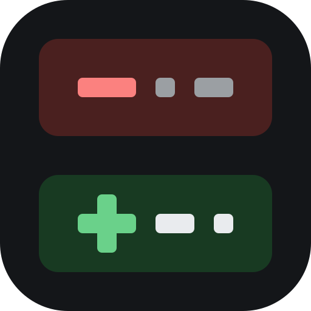

<p align="center">
  
</p>

<h1 align="center">Claude Design Kit</h1>

<p align="center">Drop-in templates that make Claude Code design like an opinionated designer-engineer instead of a template generator: interfaces that look chosen, not defaulted.</p>

<p align="center">
  <a href="https://github.com/tansuasici/claude-design-kit/blob/main/SOURCES.md">Sources</a> ·
  <a href="https://github.com/tansuasici/claude-design-kit/blob/main/CHANGELOG.md">Changelog</a>
</p>

<p align="center">
  
  
</p>

## The Problem

Out of the box, Claude Code builds interfaces that work and look like every
other AI-built page. It will:
- Reach for a purple-to-blue gradient, a glowing orb and an indigo accent
- Describe the product as "clean, modern, seamless" and design to that
- Use the framework's default type, spacing and radius without deciding anything
- Animate everything, with `transition: all` and no reduced-motion guard
- Invent metrics, testimonials and customer logos to fill a hero

None of it is wrong on its own. Together it is slop: a page a competitor could
ship unchanged.

## The Solution

This kit provides a `CLAUDE.md` ruleset, a direction file, skills, review
agents and hooks that enforce one discipline:

**Brief → Direction → Build → Audit**, every time.

The cardinal rule the whole kit exists to enforce: **every color, typeface,
spacing value, icon and animation traces back to a decision about this
product, written down in `DESIGN_MAP.md` before the CSS.**

## Quick Start

From your product repo:

```bash
npx @tansuasici/claude-design-kit init
```

Then start a Claude Code session and run `/design-brief`, then `/direction`.
`DESIGN_MAP.md` is the single most important file: it is read first every
session.

### Other ways to install

**As a Claude Code plugin**, inside Claude Code:

```
/plugin marketplace add tansuasici/claude-design-kit
/plugin install claude-design-kit@claude-design-kit
```

**From a clone:**

```bash
git clone https://github.com/tansuasici/claude-design-kit ~/claude-design-kit
bash ~/claude-design-kit/install.sh "$PWD"
```

| | npx / clone | Plugin |
|---|---|---|
| Skills, agents, hooks | copied into `.claude/` | loaded from the plugin, namespaced (`/claude-design-kit:design-brief`) |
| `CLAUDE.md` rules | installed | not loaded |
| `DESIGN_MAP.md`, `agent_docs/` | seeded in the repo | stay in the plugin; `session-start` points at them |
| Updates | `npx @tansuasici/claude-design-kit init --upgrade` | `/plugin update` |

The npx installer is the full kit. The plugin is the lighter option when you
want the skills and hooks without kit files in the repo.

### Installer options

| Flag | Description |
|------|-------------|
| `--upgrade` | Update kit-managed files |
| `--force` | Replace kit files that already exist |
| `--gitignore` | Keep the kit out of your repo |
| `--dry-run` | Print what would happen; change nothing |

Your overlay (`DESIGN_MAP.md`, `CLAUDE.project.md`, `linear.md`) is never
overwritten. An existing `.claude/settings.json` gets the kit's hooks merged in
rather than replaced. If you already have a `CLAUDE.md`, the installer keeps it
and warns; move your rules into `CLAUDE.project.md` and rerun with `--force`.

`npx @tansuasici/claude-design-kit uninstall` (or `uninstall.sh`) deletes only the files the kit installed; `--keep-project` also
keeps the overlay.

Requirements: bash, git and python3 (Node 18+ for npx). The scan hooks (`slop-scan`, `motion-gate`)
and the settings merge need python3; without it they stay silent.

## What CLAUDE.md Enforces

| Rule | What it does |
|------|-------------|
| **Tiered Session Boot** | Loads the design map and project overlay first; slop signs, tokens, motion and interface rules only when relevant |
| **Chosen, Not Defaulted** | The cardinal rule: no reflex palette, no empty character words, no invented product facts or fake assets |
| **Build Discipline** | Reuse before adding, match the codebase, tokens not literals, one spacing rhythm, three levels of hierarchy |
| **Motion Discipline** | Every animation has a reason; ease-out, under ~300ms, `transform`/`opacity` only, reduced motion respected |
| **Approval Required** | Stops before changing the direction, brand assets, shared tokens or components, adding a dependency, or writing claims |
| **Verification** | Renders → screenshots at 3 widths, light and dark → keyboard → states → slop pass → competitor test |
| **Self-Improvement** | Corrections that generalise go to `DESIGN_MAP.md → Don'ts` |

## Hooks

| Hook | Event | Does |
|---|---|---|
| `session-start.sh` | SessionStart | Reports whether `DESIGN_MAP.md` is filled, shows Character and Signature, lists `linear.md → Now`. |
| `prompt-router.sh` | UserPromptSubmit | Adds reminders for vague aesthetic asks, landing pages, motion, brand, forms and data UI. |
| `slop-scan.sh` | PostToolUse (Edit/Write) | Warns on reflex gradients, `transition-all`, ambient pulse/ping, heavy display weights, emoji icons, hype copy, and banned character words in `DESIGN_MAP.md`. |
| `motion-gate.sh` | PostToolUse (Edit/Write) | Warns on motion without a reduced-motion guard and on animated layout properties. |
| `branch-protect.sh` | PreToolUse (Bash) | Blocks pushes to `main`/`master` and force-pushes. |
| `block-dangerous-commands.sh` | PreToolUse (Bash) | Blocks destructive shell commands. |

The scan hooks warn; they never block. A file that has a reason to break a rule
can opt out with `design-kit-allow-slop` or `design-kit-allow-motion` in its
first 5 lines. Hook silence is not a design review: hooks catch class names and
keyframes, not hierarchy or taste.

## Agents

| Agent | Reads |
|---|---|
| `design-critic` | A screen against `DESIGN_MAP.md` and the slop signs. Not anchored on the code you just wrote. |
| `interface-reviewer` | Interface guidelines compliance. |
| `motion-reviewer` | Animations against the motion discipline. |

All three run on Opus and leave their findings in `.hook-state/agent-handoff.md`.

## Skills

| Skill | Use it for |
|---|---|
| `/design-brief` | Start here. Reads the project, asks once, fills Product, Competitors and the subject inventory. |
| `/direction` | Writes the five-line direction and tokens into `DESIGN_MAP.md`, then stops for approval. |
| `/slop-audit` | Finds AI-slop signs, rates the screen heavy / light / none, fixes in nine ordered passes. |
| `/interface-check` | Interface guidelines review (keyboard, focus, forms, layout, content, performance) as a Blocker / Major / Minor table. |
| `/motion-craft` | Adding an animation: frequency gate, purpose, cheapest tool, guards. |
| `/motion-review` | Reviewing existing motion: Before / After / Why table and a Block or Approve verdict. |
| `/stress-ui` | Breaks a component with empty, long, many, slow, failing and RTL inputs. |
| `/brand-method` | Logo, type and color system from a brand intake, with a reflex test. |

## What's Inside

```
CLAUDE.md                 ruleset (tiered boot, cardinal rule, approvals, verification)
DESIGN_MAP.md             the direction: Product, Character, World, Moments,
                          Signature, Tokens, Competitors, Don'ts
CLAUDE.project.md         your project overlay (never touched by upgrades)
linear.md                 open work: Now / Next / Later
agent_docs/               slop-signs, tokens, motion, interface-guidelines,
                          direction, brand-identity
.claude/skills/           8 user-invocable skills
.claude/agents/           3 review agents
.claude/hooks/            6 hooks + lib/
.claude/settings.json     hook wiring and permissions
```

## Customization

1. **Fill in `DESIGN_MAP.md`** with `/design-brief` and `/direction`. The more specific the character and signature, the less the build drifts toward generic.
2. **Customize `CLAUDE.project.md`**: stack, component library, brand constraints that override kit defaults.
3. **Grow the Don'ts.** Every visual correction that generalises goes to `DESIGN_MAP.md → Don'ts`, so it holds next session.

## Sources

The kit distills a workflow from these projects. Each one is worth installing
on its own; see [SOURCES.md](SOURCES.md) for what came from where and the
install commands.

- [unslop](https://github.com/heydamir/unslop) by Damir Sokolovsky: slop signs, tokens, direction (CC BY 4.0)
- [emilkowalski/skills](https://github.com/emilkowalski/skills) by Emil Kowalski: motion craft and review, UI stress testing (MIT)
- [taste-skill](https://github.com/Leonxlnx/taste-skill) by Leonxlnx: inventory, argument, competitor test (MIT)
- [Web Interface Guidelines](https://vercel.com/design/guidelines) by Vercel: interface rules (MIT)
- [brand-identity-skill](https://github.com/fatihaydost/brand-identity-skill) by Fatih Aydost: brand method (MIT)

## Contributing

PRs welcome. If you've found a slop sign the kit misses, or a hook false
positive, open an issue or a PR with a fixture that shows it.

## License

MIT, except three files adapted from unslop, which stay CC BY 4.0. See
[LICENSE](LICENSE) and [THIRD_PARTY_NOTICES.md](THIRD_PARTY_NOTICES.md).
